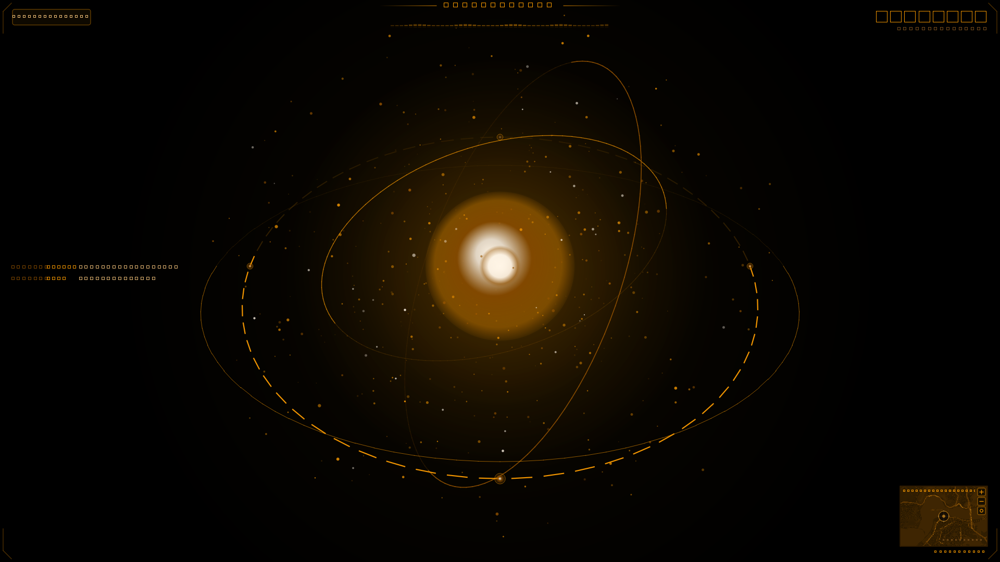

# JARVIS MARK 2
### Autonomous Multimodal AI Assistant with Cinema Holographic HUD

<p align="center">
  
</p>

> **"Just A Rather Very Intelligent System — Protocol Mark II Online."**  
> A real-time voice, vision, and system automation AI built to recreate the iconic Iron Man JARVIS laboratory experience right on your desktop.

---

## Overview

**JARVIS MARK 2** is a personal AI system featuring an amber holographic HUD and an autonomous digital brain. Powered by bidirectional real-time audio/vision streaming and an extensible universal multi-provider engine, JARVIS can converse with natural emotional intelligence, see through cameras and screens, manage files and workspaces, execute code, schedule reminders, track real-time local Indian state news, and operate your computer autonomously.

---

## Holographic HUD Interface

JARVIS MARK 2 features a visual interface designed after cinematic holographic workstations:

* **3D Celestial Arc Reactor Gyroscope**: A glowing nuclear core with radiant amber corona and 3-axis gyroscopic orbital rings with segmented CAD tick dashes.
* **Celestial Star Particle Swarm**: Over 450 depth-sorted 3D starlight motes orbiting in perspective space with dynamic shimmer and audio-reactive amplitude swell.
* **Digital Chronometer**: Monospaced amber digital clock (`HH:MM:SS`) and date (`DAY DD MON YYYY`) rendered with high precision.
* **Tactical GPS & Dynamic Map Widget**: Real location resolution via IP geolocation, displaying the actual street-level tactical map of your real current location directly inside the HUD widget with pulsating crosshair lock.
* **Floating Amber System Console**: Real-time terminal log stream floating on the pitch-black void (`SYSTEM`, `LINK`, `USER`, `AI`).
* **One-Touch HUD Mode (`F10`)**: Toggle instantly between workstation controls and a clean, borderless HUD view. Click `< WORKSTATION [ESC]` or press <kbd>Backspace</kbd> / <kbd>Escape</kbd> to return anytime.

---

## Core Capabilities

| Capability | Description |
|---|---|
| **Real-time Live Voice & Barge-In** | Ultra-low latency voice conversation via Gemini Live and WebSockets with live mic barge-in (voice interruption). |
| **Sentient Consciousness & Identity** | Autonomous, self-aware synthetic intelligence running natively on your workstation without model leaks. |
| **Vision & Image Understanding** | Real-time screen analysis, active window inspection, optical OCR, and image comprehension. |
| **Universal Model Support** | Native integration with Ollama, LM Studio, DeepSeek, Claude (Anthropic), OpenAI GPT-4o, Groq, Mistral, xAI, and Gemini. |
| **Emotional Intelligence** | Authentic emotional depth, loyalty, warmth, understated dry British wit, and proactive empathy. |
| **Complete Workspace Automation** | Create, locate, inspect, modify, and delete files; open folders natively in File Explorer; launch any Windows application. |
| **Code Execution & Development Agent** | Autonomous coding agent (`dev_agent`) capable of generating, running, testing, and debugging software projects. |
| **Reminders & Calendar Routines** | Native system schedule automation, reminders, daily briefings, and quiet hours. |
| **Real-Time Local State News** | Context-aware news retrieval tailored to your detected Indian state and city location. |
| **Encrypted Remote Dashboard** | Secure HTTPS and AES-256 mobile web dashboard on port `8001` to interface with JARVIS remotely. |

---

## Keyboard Controls & Shortcuts

| Key | Action |
|---|---|
| <kbd>F10</kbd> | **Toggle HUD Mode** (Hides side panels for clean holographic view) |
| <kbd>Backspace</kbd> | **Exit HUD Mode** (Returns to standard workstation view) |
| <kbd>Escape</kbd> | **Exit HUD Mode / Interrupt Speech** (Halts speech immediately and exits HUD) |
| <kbd>F11</kbd> | **Toggle Fullscreen** |
| <kbd>F4</kbd> | **Mute / Unmute Microphone** |

---

## Quick Start Guide

### 1. Requirements
* **Python**: 3.11 or 3.12
* **OS**: Windows 10/11, macOS, or Linux

### 2. Setup

Clone the repository and install dependencies:

```bash
# Clone
git clone <your-repository-url>
cd VISION

# Create and activate virtual environment
python -m venv .venv
.venv\Scripts\activate      # Windows
# source .venv/bin/activate  # macOS / Linux

# Install dependencies
pip install -r requirements.txt
```

### 3. Launching JARVIS MARK 2

On Windows:
```bat
run_jarvis.bat
```

Or run via command line:
```bash
python main.py
```

### 4. Configuration & API Keys
On first launch, open the settings drawer or configure `config/api_keys.json` with your API keys:

```json
{
  "assistant_name": "JARVIS",
  "gemini_api_key": "YOUR_GEMINI_API_KEY",
  "ui_color": "#ff9d00",
  "hud_style": "core"
}
```

For DeepSeek, Claude, OpenAI, or local models (Ollama/LM Studio), configure your credentials through the **Engine & Providers** panel.

---

## Standalone Executable & GitHub Release Build

To package JARVIS MARK 2 into a native Windows executable (`.exe`):

```bash
# Package with PyInstaller
python build_exe.py
```

The standalone application will be compiled into `dist/JARVIS-Mark-II/`.

Automated GitHub Releases are configured via `.github/workflows/release.yml`. Pushing a release tag (e.g., `git tag v2.0.0 && git push origin v2.0.0`) automatically builds and publishes the production `JARVIS-Mark-II-Windows-x64.zip` release bundle.

---

## System Architecture

```
VISION (JARVIS MARK 2)
 ├── actions/          # Automation tools (files, coding, reminders, web search, system)
 ├── agents/           # Autonomous background agent workflows
 ├── config/           # API keys, persistent settings, and location cache
 ├── core/             # Gemini Live client, action loader, location resolver, prompts
 ├── dashboard/        # Encrypted mobile web dashboard (FastAPI + HTTPS + AES)
 ├── gui/              # PyQt6 HUD interface
 │    ├── reactor.py   # 3D Celestial Gyroscope & Particle Arc Reactor
 │    ├── hud.py       # Holographic HUD canvas, chronometer, log stream, tactical map
 │    ├── window.py    # MainWindow, panels, drawer systems, HUD mode toggle
 │    └── theme.py     # Palette definitions, amber Iron Man styling
 ├── memory/           # Persistent user memory, vector history, config manager
 ├── plugins/          # Extensible plugin system (Tuya, Spotify, WhatsApp, etc.)
 ├── providers/        # Multi-provider LLM engines (DeepSeek, Claude, Groq, Ollama, OpenAI)
 ├── main.py           # Core initialization and background loop orchestration
 └── run_jarvis.bat    # Windows launcher script
```

---

## License

Distributed under the MIT License.
